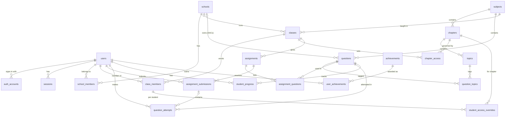

# vprepcaa database (Cloudflare D1)

The relational database behind vprepcaa: accounts, schools, classes, the global curriculum and question bank, student progress, assignments and access control. D1 database `vprepcaa-db`, bound to the Worker as `DB`.

| Path | What it is |
| --- | --- |
| `migrations/0000_auth.sql` | Better Auth tables (already applied in production) |
| `migrations/0001_identity.sql` | Renames them to users / auth_accounts / sessions, adds user fields, clears plaintext OAuth tokens, adds guards |
| `migrations/0002_schools_and_curriculum.sql` | schools, school_members, subjects, chapters, topics, questions, question_topics |
| `migrations/0003_classes_and_access.sql` | classes, class_members, chapter_access, student_access_overrides, access views |
| `migrations/0004_assignments.sql` | assignments, assignment_questions, assignment_submissions |
| `migrations/0005_progress.sql` | question_attempts, student_progress, achievements, user_achievements |
| `migrations/0006_seed_subjects.sql` | The three subjects classes can be created for (GEN34, MM34, CHEM34) |
| `migrations/0007_daily_sets.sql` | daily_sets: each student's daily questions, stored per day |
| `migrations/0009_onboarding.sql` | Open sign-up: profile columns on users, user_subjects, class_invites (class lists by email) |
| `migrations/0008_question_bank.sql` | The question bank (Notion design): study_areas, question_types, question_type_tags, question_area_tags, papers, question_stars, and new question columns |
| `worker/src/db/schema.js` | Drizzle definitions of the same tables, for queries and drizzle-kit |
| `seeds/dev.sql` | Small fictional test environment (local only) |
| `tests/db/schema.test.mjs` | 53 checks: upgrade from 0000, constraints, access rules, cascades |
| `tests/onboarding/onboarding.test.mjs` | 44 checks: open sign-up, profiles, no content without a class, class lists by email (existing and new accounts, archive, removal) |
| `tests/bank/bank.test.mjs` | 58 checks: naming conventions, bank visibility, stars, editing permissions, new papers and questions, taxonomy merge, pick-mode practice |
| `tests/auth/auth-writes.test.mjs` | 13 checks: Better Auth's own sign-in write paths on local D1 (encryption, id_token, open sign-up, allowlist roles and promotion, suspended users) |
| `scripts/dev-cookie.mjs` | Signed session cookie for a seeded user (local testing without Google) |

## Commands

```sh
npm run db:migrate:local      # apply migrations to the local D1 (.wrangler/state)
npm run db:seed:local         # load seeds/dev.sql locally (never --remote)
npm test                      # schema tests + Better Auth write-path tests (also in CI)
npm run db:migrate:remote     # production, see "Applying 0001 to production" first
npm run db:migrate:preview    # the branch-Preview database (vprepcaa-db-preview)
```

### Branch Previews

Workers Builds deploys every non-`main` branch with `npx wrangler preview`. The `previews` block in `wrangler.jsonc` points Previews at their own D1 database (`vprepcaa-db-preview`) and R2 bucket (`vprepcaa-content-preview`), so a Preview never reads or writes production data. Apply migrations there with `npm run db:migrate:preview` before pushing a branch that needs them.

Previews have no fixed `BETTER_AUTH_URL`. Better Auth takes the host from the request, limited to `AUTH_ALLOWED_HOSTS` (`*.workers.dev`). Sign-in on a Preview stays off (500) until a preview `BETTER_AUTH_SECRET` is set, because `createAuth` refuses to run without a secret instead of falling back to Better Auth's built-in default. Google sign-in also won't work there unless the preview hostname is added to the OAuth client's redirect URIs.

New schema changes: edit `worker/src/db/schema.js`, run `npx drizzle-kit generate --name <change>`, review the SQL, then add any triggers or views by hand. Never edit a migration that has been applied remotely. `npx drizzle-kit generate` currently reports "No schema changes", which confirms `schema.js` and the snapshot agree.

### Applying 0001 to production

0001 renames the three Better Auth tables, so the deployed Worker and the database must change together:

1. `npx wrangler d1 time-travel info vprepcaa-db` and note the bookmark (D1 can restore to it if anything goes wrong).
2. `npm run db:migrate:remote`
3. `npm run deploy` straight away. Between steps 2 and 3, the old Worker queries tables that no longer exist, so sign-in fails for those seconds.
4. Sign in again. Your Google tokens were cleared by 0001, and the new ones are stored encrypted.

## Conventions

- **IDs**: `TEXT` primary keys. Better Auth generates its own; app tables use `crypto.randomUUID()`. The seed uses readable IDs (`usr_student1`). `student_progress` and `question_topics` use composite keys.
- **Timestamps**: `INTEGER` milliseconds since the Unix epoch, default `(unixepoch() * 1000)`, matching Better Auth's tables. Drizzle reads them as `Date` (`mode: 'timestamp_ms'`). In raw SQL, compare with `unixepoch() * 1000` or write dates as `unixepoch('2027-02-01') * 1000`.
- **updated_at**: refreshed by an `AFTER UPDATE` trigger on every app table, unless the statement sets it. Better Auth sets its own. Append-only tables (`question_attempts`, `question_topics`, `user_achievements`) have none.
- **Booleans** are `INTEGER` 0/1 and **enums** are `TEXT`, both with `CHECK`s.
- **Foreign keys**: D1 always enforces them, and every FK has an explicit `ON DELETE` rule (see the table near the end).
- **Retire, don't delete** curriculum: set `is_active = 0` on subjects, chapters, topics, questions and achievements.
- **No exam content in git or in seed data.** Question images and solutions live in the private R2 bucket (`CONTENT`); the database stores only their keys.
- **Better Auth model names**: `schema.js` exports the auth tables as `user`, `session`, `account` and `verification` (the names Better Auth looks up), pointing at `users`, `sessions` and `auth_accounts`. No `modelName` config is needed.

## Relationship diagram



`verification` (Better Auth's short-lived OAuth state) and `allowlist` (staff roles: emails that become teachers or admins) stand alone.

## Tables

### Identity

#### `users` (Better Auth `user`)
One row per person: student, teacher or admin.
- Better Auth fields: `name`, `email` (unique), `email_verified`, `image`.
- `platform_role` is the **account type** (`student`, `teacher`, `admin`), set from `allowlist` when the account is created and enforced by triggers. What someone does in a particular class is `class_members.role`; in a school, it is `school_members.role`.
- `year_level` is 7–12 for students. `status` is `active` or `suspended`; a Better Auth hook stops suspended users starting new sessions.
- Profile (0009): `first_name`, `last_name`, `school_name`, and `onboarded_at`, set the first time the profile is saved on `/welcome`. Saving also sets `name` to "First Last". Pages send users with no `onboarded_at` to `/welcome`.
- **Relationships**: parent of auth_accounts, sessions, school_members, class_members, question_attempts, student_progress, assignment_submissions and user_achievements (all `CASCADE`). Referenced as author or actor by classes, questions, assignments, chapter_access, overrides and submissions (`SET NULL`).

#### `auth_accounts` (Better Auth `account`)
How a user signs in: one row per linked provider (Google now).
- `UNIQUE (provider_id, account_id)`: one Google identity maps to one user.
- **Credentials are never stored in plaintext.**
  - Better Auth encrypts `access_token` and `refresh_token` with `BETTER_AUTH_SECRET` (`account.encryptOAuthTokens`).
  - `id_token` is never stored. Better Auth 1.7 doesn't encrypt it, and sign-in doesn't need it again, so an account hook sets it to NULL on every write.
  - 0001 cleared the plaintext tokens written before encryption was turned on.
  - Triggers reject any token that isn't Better Auth ciphertext, and any `password` that isn't a Better Auth scrypt hash (`<hex salt>:<hex key>`). A misconfiguration fails loudly instead of leaking.
  - Email/password sign-in is not enabled.
- **Relationships**: `user_id → users` (`CASCADE`).

#### `sessions` (Better Auth `session`)
Signed-in browser sessions (30 days).
- Better Auth looks sessions up by `token`, so the token is stored as issued. The browser cookie is `token.signature`, an HMAC with `BETTER_AUTH_SECRET`, which is a Worker secret kept outside D1. A copy of this table therefore can't be turned into a working cookie: tested locally, a raw or wrongly signed token returns 401. If `BETTER_AUTH_SECRET` and the database both leaked, sessions could be forged. Rotating the secret signs everyone out.
- Indexes on `token` (unique), `user_id`, and `expires_at` (for cleanup).
- **Relationships**: `user_id → users` (`CASCADE`).

### Education

#### `schools`
A school using the platform. `UNIQUE (name, state)`. Defaults to Victoria and Australia/Melbourne.
- **Relationships**: parent of school_members (`CASCADE`). Classes and school-private questions are `RESTRICT`, so a school with classes can't be deleted (archive it with `is_active = 0`).

#### `school_members`
Who belongs to which school, and as what (`student`, `teacher`, `school_admin`). Many-to-many, so a teacher can work at two schools and a student can change schools without a new account. `UNIQUE (school_id, user_id)`.
- **Relationships**: `school_id → schools` and `user_id → users` (both `CASCADE`).

#### `subjects`
A VCE study, e.g. `GEN34` General Mathematics Units 3&4. `code` is unique. Global: not owned by any school or class.
- **Relationships**: parent of chapters, questions and classes (all `RESTRICT`).

#### `chapters`
Ordered units within a subject (a textbook chapter or area of study): the unit teachers open or lock for a class. `UNIQUE (subject_id, position)` and `UNIQUE (subject_id, code)`.
- **Relationships**: `subject_id → subjects` (`RESTRICT`). Parent of topics (`RESTRICT`), and of chapter_access and student_access_overrides (`CASCADE`).

#### `topics`
Ordered sections within a chapter (e.g. exercise `1F`). `UNIQUE (chapter_id, position)` and `UNIQUE (chapter_id, code)`.
- **Relationships**: `chapter_id → chapters` (`RESTRICT`). Referenced by question_topics (`RESTRICT`).

#### `questions`
Every practice question: VCAA exam, SAC, textbook or custom.
- `school_id IS NULL` means **global** content, available to every school. When it's set, the question is **private to that school**. A `CHECK` makes this mandatory for `source_type = 'sac'`, so SAC material never reaches another school.
- `source_ref` (e.g. `2021 E1 M2 Q1`) is unique per subject among global questions, and per subject per school among private ones (two partial unique indexes).
- Paper metadata: `year`, `exam` (`E1`/`E2`), `is_nht`, `section`, `question_number`, `format`, `marks`, and `correct_option` (allowed only on multiple-choice questions).
- Content: `image_key` and `solution_key` point into private R2.
- Statistics: `difficulty`, `state_pct_correct`, `in_study_design`.
- **Relationships**:
  - `subject_id → subjects` (`RESTRICT`), `school_id → schools` (`RESTRICT`), `created_by → users` (`SET NULL`).
  - Parent of question_topics and student_progress (`CASCADE`).
  - Parent of question_attempts and assignment_questions (`RESTRICT`): a question that has been answered, or is on an assignment, can only be retired.

Added in 0008 for the question bank: `paper_id → papers` (`SET NULL`), `state_avg` (0–1, mean score as a share of marks), `zero_pct` (0–100, share of students who scored zero), `how_often` (`every_year`, `two_of_three`, `repeated_within_year`, `once`, `not_classified`), `top_distractor` (e.g. `C (29%)`), `tag_source` (`keyword`, `ocr_verify`, `solutions`, `reviewed`) and `updated_by`.

#### `question_topics`
Many-to-many tags between questions and topics, matching the bank's multi-valued topics. Primary key `(question_id, topic_id)`. Exactly one tag per question may be primary (a partial unique index). **The primary topic's chapter decides whether a student can see the question.**
- **Relationships**: `question_id → questions` (`CASCADE`), `topic_id → topics` (`RESTRICT`).

#### `classes`
A teaching group for one subject in one year (e.g. `12GEN-A`, 2026).
- `school_id` is NULL for groups outside a school, such as private tutoring.
- `join_code` is an optional, unique code students type to join.
- `default_chapter_access` (`open` or `locked`) applies to chapters with no rule of their own.
- `is_archived` hides the class and switches off its access rules, without deleting history.
- **Relationships**: `school_id → schools` (`RESTRICT`), `subject_id → subjects` (`RESTRICT`), `created_by → users` (`SET NULL`). Parent of class_members, chapter_access and assignments (`CASCADE`); referenced by question_attempts (`SET NULL`).

#### `class_members`
Enrolment for teachers and students alike, with a per-class `role`.
- `UNIQUE (class_id, user_id)` **prevents duplicate enrolment**.
- Students can be in many classes, and teachers can run many classes: one row per class. Co-teaching is two teacher rows.
- A trigger stops a `student` account being given the `teacher` role.
- Indexes: `(user_id, role)` for "my classes", and `(class_id, role)` for rosters.
- **Relationships**: `class_id → classes` and `user_id → users` (both `CASCADE`). Parent of student_access_overrides through `(class_id, user_id)`.

#### Class codes (sign-up and joining)

`classes.join_code` is a 6-character code from an alphabet without look-alikes (no 0/O, 1/I/L), generated by `worker/src/lib/classes.js` when a teacher creates a class.

Since migration 0009 **anyone can create an account** with Google. It is a student account unless the email is on `allowlist` with another role; a student account whose email is later put on the allowlist as a teacher or admin is promoted on its next sign-in. A student in no class can't see any exam content (access comes from class membership, see below), so the dashboard asks them to join one first.

How the code survives the Google redirect:

1. `POST /api/v1/join/start` checks the code and sets `vp_join`, a 15-minute HttpOnly cookie signed with `BETTER_AUTH_SECRET` (`worker/src/lib/join-cookie.js`).
2. Better Auth's `session.create.after` hook reads that cookie during the Google callback and enrols the student (`class_members`, role `student`, idempotent).
3. The dashboard calls `POST /api/v1/join/finish` to confirm and clear the cookie.

Signed-in students join more classes with `POST /api/v1/classes/join`.

#### `class_invites` and `user_subjects` (migration 0009)
- `class_invites`: emails a teacher has added to a class (unique per class; stored lower-case, checked by the database). On every sign-in, and on `GET /api/v1/me`, a student is put into each non-archived class that lists their email, and the row gets `accepted_by` and `accepted_at`. Adding the email of an existing student account enrols it straight away; teacher and admin emails are listed but never enrolled. Removing an email doesn't remove a student who already joined. Only the class's teachers (and admins) can see or change the list. `class_id → classes` (`CASCADE`), `invited_by`, `accepted_by → users` (`SET NULL`).
- `user_subjects`: the subjects on a profile (studying or teaching), primary key `(user_id, subject_id)`, both `CASCADE`. Informational: class membership, not this, decides what a student sees. Teacher and admin accounts are never enrolled as students. Codes of archived classes stop working. `GET /api/v1/join/:code` shows only the class name, subject, school and year. Tests: `tests/auth/join.test.mjs`.

### Question bank (migration 0008)

The Notion question bank rebuilt in D1. A question carries three classifications: its **chapter topic** (`question_topics`, which decides access), its **question type** and its **study design area** (both for filtering, colour and mastery).

#### `study_areas`
A subject's Areas of Study, each with a Notion colour (`default gray brown orange yellow green blue purple pink red`). Unique `(subject_id, code)`. Imported colours: Methods AoS1 blue, AoS2 green, AoS3 purple, AoS4 orange; General Data blue, Recursion green, Matrices yellow, Networks red; Chemistry U3A1 blue, U3A2 green, U4A1 purple, U4A2 orange, Cross gray.

#### `question_types`
The skill a question tests ("Boxplot construction and interpretation"). Unique name per subject; belongs to one study area; `colour` NULL means it takes the area's colour. `is_active = 0` hides a type without losing its tags. It is the unit for daily-set mastery and the dashboard's weak spots (falling back to the primary topic when a question has no type).

#### `question_type_tags`, `question_area_tags`
Many-to-many tags. One type tag per question may be primary (partial unique index); the first in an edit is primary. Both cascade from the question.

#### `papers`
One exam paper or SAC. `code` follows Notion (`2024_VCAA_E1`, `2023_VCAA-NHT_E2`, Chemistry `2024_VCAA`, school papers `2025_SAC2`); `source` is `vcaa`, `vcaa_nht`, `sac`, `trial` or `other`. `school_id IS NULL` is shared; otherwise the paper is private to the school. Codes are unique among shared papers and per school (two partial indexes).

#### `question_stars`
A user's starred questions, primary key `(user_id, question_id)`.

#### Question names
`web/js/naming.js` (used by the browser and the Worker) builds names the Notion way:
- General: `2024 E2 Q13`, `2017 E2 M2 Q1`, `2023 NHT E2 Q4` (multiple choice is still `Q`).
- Methods: `2024 E2 MC7`, `2024 E1 Q3`, `2026NHT E2 MC9`.
- Chemistry: `2017 A Q1`, `2017 B Q5` (section, no exam number).
New questions get these names automatically; the name stays editable and must be unique within the subject.

#### Who can edit
| | Shared VCAA bank | Their school's papers and questions | Question types and areas |
| --- | --- | --- | --- |
| Student | read (open chapters, published, in study design) | read | — |
| Teacher / school admin | read everything, incl. drafts and answers | add and edit | — |
| Admin | add and edit | add and edit | add, rename, recolour, merge |

New questions start as drafts (`is_active = 0`) until published. Merging a type moves its tags onto the other type, keeps each question's primary tag and deletes the old type.

### Student progress

#### `question_attempts`
An append-only log of every answer a student submits.
- What it records: marks awarded and available, the MC option chosen, and `response_json` (part marks, keys for saved working).
- How it was marked (`auto`, `self`, `teacher`), whether the solution was viewed, whether it was a redo, and the time taken.
- Where it came from: `daily`, `weekly`, `topic`, `history`, `assignment` or `free`.
- `CHECK`s: `marks_awarded ≤ marks_available`, and `submission_id` is only allowed when `source = 'assignment'`.
- Indexes: per student by time, per student per question, per class by time (teacher dashboard), and per submission.
- **Relationships**: `user_id → users` (`CASCADE`), `question_id → questions` (`RESTRICT`). `class_id → classes` and `submission_id → assignment_submissions` are `SET NULL`, so deleting a class or assignment keeps the student's history.

#### `student_progress`
Current state per student per question, recomputed by the Worker after each attempt.
- Counts, best and last marks, and first and last attempt times.
- The spaced-repetition schedule: `srs_step` (an index into 1, 3, 7, 16, 35 and 70 days), `srs_interval_days` and `srs_due_at`.
- `mastery` (0–1) and `on_fix_list`.

This replaces the original app's per-device IndexedDB state, so progress syncs across devices. Topic, chapter and subject mastery are aggregated by joining through `question_topics`. Primary key `(user_id, question_id)`, with indexes for "due now" and the fix list.
- **Relationships**: `user_id → users` and `question_id → questions` (both `CASCADE`, because it is derived data).

#### `daily_sets` (migration 0007)
A student's daily questions for one subject on one day, frozen so reloads and other devices see the same set.
- `set_date` is the Melbourne calendar day (`YYYY-MM-DD`); `UNIQUE (user_id, subject_id, set_date)`.
- `items_json` is an ordered array of `{"q": question id, "k": kind}`, kind being `fix`, `retrieval`, `strengthen`, `stretch` or `new`.
- Written by `GET /api/v1/dashboard` the first time a student opens it each day (`worker/src/lib/daily.js` chooses the questions with the Pixel Practice rules, from chapters their teacher has opened). A question counts as done when the student answers it that day, from any source.
- **Relationships**: `user_id → users` and `subject_id → subjects` (both `CASCADE`).

#### `achievements`
The badge catalogue (global): `code` (unique), name, description, `category`, `icon_key` (an R2 pixel-art badge), `criteria_json` and `points`.
- **Relationships**: parent of user_achievements (`RESTRICT`; retire with `is_active = 0`).

#### `user_achievements`
Which student earned which badge, and when, with an optional `context_json` (e.g. the subject). `UNIQUE (user_id, achievement_id)`.
- **Relationships**: `user_id → users` (`CASCADE`), `achievement_id → achievements` (`RESTRICT`).

### Classroom management

#### `assignments`
A question set a teacher gives one class.
- Fields: title, instructions, `status` (`draft`, `published`, `closed`), `opens_at`, `due_at`, an optional time limit, `allow_late`, and `solutions_visibility` (`after_submit`, `after_due`, `never`).
- `CHECK`s: the due date must be after the open date, and anything that isn't a draft must have `published_at`.
- **Relationships**: `class_id → classes` (`CASCADE`), `created_by → users` (`SET NULL`). Parent of assignment_questions and assignment_submissions (`CASCADE`).

#### `assignment_questions`
The ordered questions in an assignment, with an optional `marks_override`. `UNIQUE (assignment_id, question_id)` and `UNIQUE (assignment_id, position)`.
- **Relationships**: `assignment_id → assignments` (`CASCADE`), `question_id → questions` (`RESTRICT`).

#### `assignment_submissions`
One per student per assignment (`UNIQUE (assignment_id, student_id)`).
- Fields: `status` (`in_progress`, `submitted`, `marked`, `returned`), start and submit times, `is_late`, `score` and `max_score`, feedback, and who marked it and when.
- The individual answers are `question_attempts` rows that carry this `submission_id`.
- A trigger allows only students enrolled in the assignment's class to start one.
- **Relationships**: `assignment_id → assignments` and `student_id → users` (both `CASCADE`), `marked_by → users` (`SET NULL`).

### Access control

The curriculum tables say nothing about who may see what. Access lives only in these two tables, scoped to a class.

#### `chapter_access`
A class's rule for one chapter: `open` or `locked`. An `open` rule may have a window (`opens_at` inclusive, `closes_at` exclusive) for scheduled unlocks. `UNIQUE (class_id, chapter_id)`. A trigger rejects chapters from a different subject than the class.
- **Relationships**: `class_id → classes` and `chapter_id → chapters` (both `CASCADE`), `set_by → users` (`SET NULL`).

#### `student_access_overrides`
An exception for one student, one chapter, within one class: `grant` or `deny`, with an optional `reason` and `expires_at`. `UNIQUE (class_id, student_id, chapter_id)`.
- The composite foreign key `(class_id, student_id) → class_members (class_id, user_id)` means the student **must be enrolled** in the class, and their overrides are removed automatically when they leave it.
- **Relationships**: `(class_id, student_id) → class_members` (`CASCADE`), `chapter_id → chapters` (`CASCADE`), `created_by → users` (`SET NULL`).

#### How access is resolved

For each class a student is in that isn't archived, each chapter of that class's subject resolves like this:

1. If there is an unexpired **student override**, `grant` means open and `deny` means locked.
2. Otherwise, if there is a **chapter_access** rule, the chapter is open only when `access = 'open'` and the current time is inside its window.
3. Otherwise, the class's **default_chapter_access** applies.

A student can see a chapter if **any** of their classes resolves to open. A question is visible if its primary topic's chapter is visible; for a school-private question, the student must also belong to that school (checked in the Worker).

Two views hold this logic, so the Worker never repeats it (Drizzle: `vStudentClassChapterAccess`, `vStudentChapterAccess`):
- `v_student_class_chapter_access` has one row per student, class and chapter, with `can_access` and `decided_by` (`student_override`, `chapter_access` or `class_default`). This feeds the teacher's access screen.
- `v_student_chapter_access` has one row per student and chapter, with the combined `can_access`.

```sql
SELECT chapter_id FROM v_student_chapter_access WHERE student_id = ?1 AND can_access = 1;
```

Students with no class in a subject get no rows for it. If self-study without a class is wanted later, add a subject-level "open practice" flag and union it into the view.

## Delete rules

| Deleting… | What happens |
| --- | --- |
| a **user** | Their sign-in accounts, sessions, school and class memberships, overrides, attempts, progress, submissions and badges are deleted (full erasure). Content they authored stays, with `created_by`, `set_by` and `marked_by` set to NULL. |
| a **class** | Its members, access rules, overrides, assignments and submissions are deleted. Students' attempts stay, with `class_id` and `submission_id` set to NULL. Archiving (`is_archived = 1`) is usually the better choice. |
| an **assignment** | Its question list and submissions are deleted. The attempts stay, unlinked. |
| a **school** | Blocked while it still has classes or private questions. |
| a **subject, chapter or topic** | Blocked while anything below it exists. Retire it instead. |
| a **question** | Blocked once it has been attempted or used in an assignment. Retire it instead. |
| an **achievement** | Blocked once awarded. Retire it instead. |

## What the database enforces, and what the Worker must

**The database enforces:**
- No duplicate enrolment, submission, access rule, override, badge award, or question within an assignment.
- No plaintext OAuth tokens or passwords.
- Valid roles.
- SAC questions are always school-private, and each question has exactly one primary topic.
- MC answers only on MC questions, and marks awarded never exceed marks available.
- Student accounts can't teach a class.
- Access rules must match the class's subject.
- Only enrolled students can start a submission.

**The Worker must check:**
- Only a class's teachers may change its rules or mark its work.
- Assignments may only contain questions the class can access.
- School-private questions are shown only to members of that school.
- `student_progress` is recomputed after each attempt.

## Seed data (`seeds/dev.sql`)

`seeds/dev-dashboard.sql` loads after it (`npm run db:seed:local` runs both): 9 more `TEST` questions, homework that is open now (one due tomorrow, one next week, one not open yet), and five days of daily questions for Lena ending yesterday. Its times are relative to when it runs, so her streak and due dates always look live.

Everything is fictional: `.test` emails, question refs starting `TEST`, invented statistics, and placeholder R2 keys. There is no VCAA content.

- **People:** 1 school; 3 staff (an admin who co-teaches and runs a tutoring group, plus two teachers); 5 students, one of them suspended. All are on the allowlist with Google links, and none have tokens.
- **Curriculum:** GEN34 and MM34, with 6 chapters and 10 topics between them, and 8 questions. One question is a school-private SAC; one carries a secondary topic tag.
- **Classes:** `12GEN-A` (default locked), `12MM-A` (default open) and a tutoring group with no school. Tom is in all three, so his GEN34 access combines two classes.
- **Access cases:** an open chapter, a scheduled unlock, an explicit lock, a grant override (extension work) and an expiring deny override.
- **Classroom and progress:** 2 assignments (one published, one draft); submissions that are marked, late and in progress; 8 attempts; progress rows; and 3 badges.

### Local testing without Google

The seed creates sessions for `usr_student1` and `usr_teacher1`. With `BETTER_AUTH_SECRET` set in `.dev.vars`:

```sh
npm run db:migrate:local && npm run db:seed:local
npx wrangler dev --var BETTER_AUTH_URL:http://localhost:8787
curl -H "Cookie: $(node scripts/dev-cookie.mjs dev-session-token-student-1 "$BETTER_AUTH_SECRET")" \
  http://localhost:8787/api/v1/me
```

Verified 18 Nov 2026: all migrations apply in local D1 (wrangler), the seed loads, `/api/v1/me` returns the seeded student through Better Auth on the renamed tables, `npm test` passes 53/53 schema and 12/12 auth checks, `npm run check` passes, and `drizzle-kit generate` reports no drift.

## Importing the question banks

The Pixel Practice banks (`vcaa-bank.zip` for General and Methods, `chem-bank.zip` for Chemistry) are imported with `scripts/import-bank.mjs`. Exam content never enters git: everything it writes goes to `content/` (ignored).

```sh
# unzip each bank into its own folder first
npm run import:bank -- --vcaa ../banks/vcaa --chem ../banks/chem
npx wrangler d1 execute vprepcaa-db --remote --file=content/import/01_curriculum.sql
npx wrangler d1 execute vprepcaa-db --remote --file=content/import/02_questions.sql
npx wrangler d1 execute vprepcaa-db --remote --file=content/import/03_bank.sql   # areas, types, papers, tags, exam stats
npm run upload:content -- --remote          # images and solutions to the private R2 bucket
```

- Curriculum: General chapters are the Cambridge chapters (1–5, 7, 8, 10, 11, 13, 14; revision chapters left out) with exercises as topics; Methods chapters are the four Areas of Study with the 13 Pixel Practice topics; Chemistry chapters are the four Unit/AoS areas plus Cross-topic, with the 53 question types as topics. A question is tagged with all its topics; the first is primary.
- `03_bank.sql` (needs migration 0008) writes the bank design: General 18 papers, 4 areas, 63 types; Methods 28 papers, 4 areas, 58 types; Chemistry 9 papers, 5 areas, 53 types. Each type goes in the area most of its questions are in. Type ids are `qt_<subject>_<slug>` and paper ids `pp_<subject>_<code>`, so it re-runs safely.
- Question ids are `q_<Notion page id>`, so a re-import updates rows in place (statements are upserts) and keeps every attempt linked.
- R2 keys: `q/<gen34|mm34|chem34>/<ref>.png` for question images, `s/<subject>/<question id>.json` for solutions: `{ ref, sec: [{t, md}], parts: [{label, marks, avg, zeroPct, solution, notes}] }`. `parts` splits a written question for self-marking (`scripts/lib/solution-parts.mjs`): 129/142 General, 109/186 Methods and 84/84 Chemistry written questions split; the rest are single-part and are marked whole.
- `npm run upload:content` with no flags writes to local R2 in-process (about 15 seconds for the whole bank); `--remote` uploads with wrangler and can be resumed.
- Run it on a local database first (`--local`). Don't run it on top of `seeds/dev.sql`: the seed's fictional chapters use the same chapter codes.
- Verified 18 Nov 2026 against the uploaded banks: 20 chapters, 134 topics, 1,332 questions (512 General, 466 Methods, 354 Chemistry), all MC answers present except 4 voided Chemistry questions; 3 questions have no image (Methods 2018 E2 MC14 and MC17, Chemistry 2022 B Q1).
