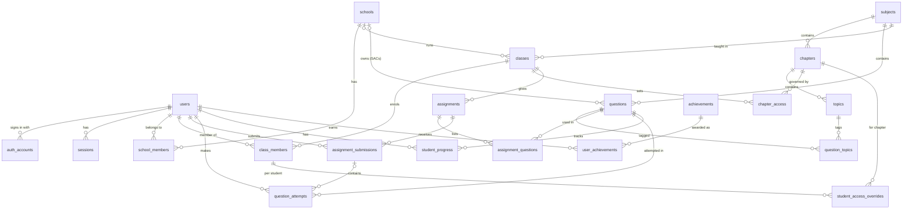

# vprepcaa database (Cloudflare D1)

The relational database behind vprepcaa: accounts, schools, classes, the global curriculum and question bank, student progress, assignments and access control. D1 database `vprepcaa-db`, bound to the Worker as `DB`.

| Path | What it is |
| --- | --- |
| `migrations/0000_auth.sql` | Better Auth tables (already applied in production) |
| `migrations/0001_identity.sql` | Renames them to users / auth_accounts / sessions, adds user fields, clears plaintext OAuth tokens, adds guards |
| `migrations/0002_schools_and_curriculum.sql` | schools, school_members, subjects, chapters, topics, questions, question_topics |
| `migrations/0003_classes_and_access.sql` | classes, class_members, chapter_access, student_access_overrides, access views |
| `migrations/0004_assignments.sql` | assignments, assignment_questions, assignment_submissions |
| `migrations/0005_progress.sql` | question_attempts, student_progress, achievements, user_achievements |
| `worker/src/db/schema.js` | Drizzle definitions of the same tables, for queries and drizzle-kit |
| `seeds/dev.sql` | Small fictional test environment (local only) |
| `tests/db/schema.test.mjs` | 53 checks: upgrade from 0000, constraints, access rules, cascades |
| `tests/auth/auth-writes.test.mjs` | 12 checks: Better Auth's own sign-in write paths on local D1 (encryption, id_token, allowlist, suspended users) |
| `scripts/dev-cookie.mjs` | Signed session cookie for a seeded user (local testing without Google) |

## Commands

```sh
npm run db:migrate:local      # apply migrations to the local D1 (.wrangler/state)
npm run db:seed:local         # load seeds/dev.sql locally (never --remote)
npm test                      # schema tests + Better Auth write-path tests (also in CI)
npm run db:migrate:remote     # production, see "Applying 0001 to production" first
npm run db:migrate:preview    # the branch-Preview database (vprepcaa-db-preview)
```

### Branch Previews

Workers Builds deploys every non-`main` branch with `npx wrangler preview`. The `previews` block in `wrangler.jsonc` points Previews at their own D1 database (`vprepcaa-db-preview`) and R2 bucket (`vprepcaa-content-preview`), so a Preview never reads or writes production data. Apply migrations there with `npm run db:migrate:preview` before pushing a branch that needs them.

Previews have no fixed `BETTER_AUTH_URL`. Better Auth takes the host from the request, limited to `AUTH_ALLOWED_HOSTS` (`*.workers.dev`). Sign-in on a Preview stays off (500) until a preview `BETTER_AUTH_SECRET` is set, because `createAuth` refuses to run without a secret instead of falling back to Better Auth's built-in default. Google sign-in also won't work there unless the preview hostname is added to the OAuth client's redirect URIs.

New schema changes: edit `worker/src/db/schema.js`, run `npx drizzle-kit generate --name <change>`, review the SQL, then add any triggers or views by hand. Never edit a migration that has been applied remotely. `npx drizzle-kit generate` currently reports "No schema changes", which confirms `schema.js` and the snapshot agree.

### Applying 0001 to production

0001 renames the three Better Auth tables, so the deployed Worker and the database must change together:

1. `npx wrangler d1 time-travel info vprepcaa-db` and note the bookmark (D1 can restore to it if anything goes wrong).
2. `npm run db:migrate:remote`
3. `npm run deploy` straight away. Between steps 2 and 3, the old Worker queries tables that no longer exist, so sign-in fails for those seconds.
4. Sign in again. Your Google tokens were cleared by 0001, and the new ones are stored encrypted.

## Conventions

- **IDs**: `TEXT` primary keys. Better Auth generates its own; app tables use `crypto.randomUUID()`. The seed uses readable IDs (`usr_student1`). `student_progress` and `question_topics` use composite keys.
- **Timestamps**: `INTEGER` milliseconds since the Unix epoch, default `(unixepoch() * 1000)`, matching Better Auth's tables. Drizzle reads them as `Date` (`mode: 'timestamp_ms'`). In raw SQL, compare with `unixepoch() * 1000` or write dates as `unixepoch('2027-02-01') * 1000`.
- **updated_at**: refreshed by an `AFTER UPDATE` trigger on every app table, unless the statement sets it. Better Auth sets its own. Append-only tables (`question_attempts`, `question_topics`, `user_achievements`) have none.
- **Booleans** are `INTEGER` 0/1 and **enums** are `TEXT`, both with `CHECK`s.
- **Foreign keys**: D1 always enforces them, and every FK has an explicit `ON DELETE` rule (see the table near the end).
- **Retire, don't delete** curriculum: set `is_active = 0` on subjects, chapters, topics, questions and achievements.
- **No exam content in git or in seed data.** Question images and solutions live in the private R2 bucket (`CONTENT`); the database stores only their keys.
- **Better Auth model names**: `schema.js` exports the auth tables as `user`, `session`, `account` and `verification` (the names Better Auth looks up), pointing at `users`, `sessions` and `auth_accounts`. No `modelName` config is needed.

## Relationship diagram



`verification` (Better Auth's short-lived OAuth state) and `allowlist` (invite list) stand alone.

## Tables

### Identity

#### `users` (Better Auth `user`)
One row per person: student, teacher or admin.
- Better Auth fields: `name`, `email` (unique), `email_verified`, `image`.
- `platform_role` is the **account type** (`student`, `teacher`, `admin`), set from `allowlist` when the account is created and enforced by triggers. What someone does in a particular class is `class_members.role`; in a school, it is `school_members.role`.
- `year_level` is 7–12 for students. `status` is `active` or `suspended`; a Better Auth hook stops suspended users starting new sessions.
- **Relationships**: parent of auth_accounts, sessions, school_members, class_members, question_attempts, student_progress, assignment_submissions and user_achievements (all `CASCADE`). Referenced as author or actor by classes, questions, assignments, chapter_access, overrides and submissions (`SET NULL`).

#### `auth_accounts` (Better Auth `account`)
How a user signs in: one row per linked provider (Google now).
- `UNIQUE (provider_id, account_id)`: one Google identity maps to one user.
- **Credentials are never stored in plaintext.**
  - Better Auth encrypts `access_token` and `refresh_token` with `BETTER_AUTH_SECRET` (`account.encryptOAuthTokens`).
  - `id_token` is never stored. Better Auth 1.7 doesn't encrypt it, and sign-in doesn't need it again, so an account hook sets it to NULL on every write.
  - 0001 cleared the plaintext tokens written before encryption was turned on.
  - Triggers reject any token that isn't Better Auth ciphertext, and any `password` that isn't a Better Auth scrypt hash (`<hex salt>:<hex key>`). A misconfiguration fails loudly instead of leaking.
  - Email/password sign-in is not enabled.
- **Relationships**: `user_id → users` (`CASCADE`).

#### `sessions` (Better Auth `session`)
Signed-in browser sessions (30 days).
- Better Auth looks sessions up by `token`, so the token is stored as issued. The browser cookie is `token.signature`, an HMAC with `BETTER_AUTH_SECRET`, which is a Worker secret kept outside D1. A copy of this table therefore can't be turned into a working cookie: tested locally, a raw or wrongly signed token returns 401. If `BETTER_AUTH_SECRET` and the database both leaked, sessions could be forged. Rotating the secret signs everyone out.
- Indexes on `token` (unique), `user_id`, and `expires_at` (for cleanup).
- **Relationships**: `user_id → users` (`CASCADE`).

### Education

#### `schools`
A school using the platform. `UNIQUE (name, state)`. Defaults to Victoria and Australia/Melbourne.
- **Relationships**: parent of school_members (`CASCADE`). Classes and school-private questions are `RESTRICT`, so a school with classes can't be deleted (archive it with `is_active = 0`).

#### `school_members`
Who belongs to which school, and as what (`student`, `teacher`, `school_admin`). Many-to-many, so a teacher can work at two schools and a student can change schools without a new account. `UNIQUE (school_id, user_id)`.
- **Relationships**: `school_id → schools` and `user_id → users` (both `CASCADE`).

#### `subjects`
A VCE study, e.g. `GEN34` General Mathematics Units 3&4. `code` is unique. Global: not owned by any school or class.
- **Relationships**: parent of chapters, questions and classes (all `RESTRICT`).

#### `chapters`
Ordered units within a subject (a textbook chapter or area of study): the unit teachers open or lock for a class. `UNIQUE (subject_id, position)` and `UNIQUE (subject_id, code)`.
- **Relationships**: `subject_id → subjects` (`RESTRICT`). Parent of topics (`RESTRICT`), and of chapter_access and student_access_overrides (`CASCADE`).

#### `topics`
Ordered sections within a chapter (e.g. exercise `1F`). `UNIQUE (chapter_id, position)` and `UNIQUE (chapter_id, code)`.
- **Relationships**: `chapter_id → chapters` (`RESTRICT`). Referenced by question_topics (`RESTRICT`).

#### `questions`
Every practice question: VCAA exam, SAC, textbook or custom.
- `school_id IS NULL` means **global** content, available to every school. When it's set, the question is **private to that school**. A `CHECK` makes this mandatory for `source_type = 'sac'`, so SAC material never reaches another school.
- `source_ref` (e.g. `2021 E1 M2 Q1`) is unique per subject among global questions, and per subject per school among private ones (two partial unique indexes).
- Paper metadata: `year`, `exam` (`E1`/`E2`), `is_nht`, `section`, `question_number`, `format`, `marks`, and `correct_option` (allowed only on multiple-choice questions).
- Content: `image_key` and `solution_key` point into private R2.
- Statistics: `difficulty`, `state_pct_correct`, `in_study_design`.
- **Relationships**:
  - `subject_id → subjects` (`RESTRICT`), `school_id → schools` (`RESTRICT`), `created_by → users` (`SET NULL`).
  - Parent of question_topics and student_progress (`CASCADE`).
  - Parent of question_attempts and assignment_questions (`RESTRICT`): a question that has been answered, or is on an assignment, can only be retired.

#### `question_topics`
Many-to-many tags between questions and topics, matching the bank's multi-valued topics. Primary key `(question_id, topic_id)`. Exactly one tag per question may be primary (a partial unique index). **The primary topic's chapter decides whether a student can see the question.**
- **Relationships**: `question_id → questions` (`CASCADE`), `topic_id → topics` (`RESTRICT`).

#### `classes`
A teaching group for one subject in one year (e.g. `12GEN-A`, 2026).
- `school_id` is NULL for groups outside a school, such as private tutoring.
- `join_code` is an optional, unique code students type to join.
- `default_chapter_access` (`open` or `locked`) applies to chapters with no rule of their own.
- `is_archived` hides the class and switches off its access rules, without deleting history.
- **Relationships**: `school_id → schools` (`RESTRICT`), `subject_id → subjects` (`RESTRICT`), `created_by → users` (`SET NULL`). Parent of class_members, chapter_access and assignments (`CASCADE`); referenced by question_attempts (`SET NULL`).

#### `class_members`
Enrolment for teachers and students alike, with a per-class `role`.
- `UNIQUE (class_id, user_id)` **prevents duplicate enrolment**.
- Students can be in many classes, and teachers can run many classes: one row per class. Co-teaching is two teacher rows.
- A trigger stops a `student` account being given the `teacher` role.
- Indexes: `(user_id, role)` for "my classes", and `(class_id, role)` for rosters.
- **Relationships**: `class_id → classes` and `user_id → users` (both `CASCADE`). Parent of student_access_overrides through `(class_id, user_id)`.

### Student progress

#### `question_attempts`
An append-only log of every answer a student submits.
- What it records: marks awarded and available, the MC option chosen, and `response_json` (part marks, keys for saved working).
- How it was marked (`auto`, `self`, `teacher`), whether the solution was viewed, whether it was a redo, and the time taken.
- Where it came from: `daily`, `weekly`, `topic`, `history`, `assignment` or `free`.
- `CHECK`s: `marks_awarded ≤ marks_available`, and `submission_id` is only allowed when `source = 'assignment'`.
- Indexes: per student by time, per student per question, per class by time (teacher dashboard), and per submission.
- **Relationships**: `user_id → users` (`CASCADE`), `question_id → questions` (`RESTRICT`). `class_id → classes` and `submission_id → assignment_submissions` are `SET NULL`, so deleting a class or assignment keeps the student's history.

#### `student_progress`
Current state per student per question, recomputed by the Worker after each attempt.
- Counts, best and last marks, and first and last attempt times.
- The spaced-repetition schedule: `srs_step` (an index into 1, 3, 7, 16, 35 and 70 days), `srs_interval_days` and `srs_due_at`.
- `mastery` (0–1) and `on_fix_list`.

This replaces the original app's per-device IndexedDB state, so progress syncs across devices. Topic, chapter and subject mastery are aggregated by joining through `question_topics`. Primary key `(user_id, question_id)`, with indexes for "due now" and the fix list.
- **Relationships**: `user_id → users` and `question_id → questions` (both `CASCADE`, because it is derived data).

#### `achievements`
The badge catalogue (global): `code` (unique), name, description, `category`, `icon_key` (an R2 pixel-art badge), `criteria_json` and `points`.
- **Relationships**: parent of user_achievements (`RESTRICT`; retire with `is_active = 0`).

#### `user_achievements`
Which student earned which badge, and when, with an optional `context_json` (e.g. the subject). `UNIQUE (user_id, achievement_id)`.
- **Relationships**: `user_id → users` (`CASCADE`), `achievement_id → achievements` (`RESTRICT`).

### Classroom management

#### `assignments`
A question set a teacher gives one class.
- Fields: title, instructions, `status` (`draft`, `published`, `closed`), `opens_at`, `due_at`, an optional time limit, `allow_late`, and `solutions_visibility` (`after_submit`, `after_due`, `never`).
- `CHECK`s: the due date must be after the open date, and anything that isn't a draft must have `published_at`.
- **Relationships**: `class_id → classes` (`CASCADE`), `created_by → users` (`SET NULL`). Parent of assignment_questions and assignment_submissions (`CASCADE`).

#### `assignment_questions`
The ordered questions in an assignment, with an optional `marks_override`. `UNIQUE (assignment_id, question_id)` and `UNIQUE (assignment_id, position)`.
- **Relationships**: `assignment_id → assignments` (`CASCADE`), `question_id → questions` (`RESTRICT`).

#### `assignment_submissions`
One per student per assignment (`UNIQUE (assignment_id, student_id)`).
- Fields: `status` (`in_progress`, `submitted`, `marked`, `returned`), start and submit times, `is_late`, `score` and `max_score`, feedback, and who marked it and when.
- The individual answers are `question_attempts` rows that carry this `submission_id`.
- A trigger allows only students enrolled in the assignment's class to start one.
- **Relationships**: `assignment_id → assignments` and `student_id → users` (both `CASCADE`), `marked_by → users` (`SET NULL`).

### Access control

The curriculum tables say nothing about who may see what. Access lives only in these two tables, scoped to a class.

#### `chapter_access`
A class's rule for one chapter: `open` or `locked`. An `open` rule may have a window (`opens_at` inclusive, `closes_at` exclusive) for scheduled unlocks. `UNIQUE (class_id, chapter_id)`. A trigger rejects chapters from a different subject than the class.
- **Relationships**: `class_id → classes` and `chapter_id → chapters` (both `CASCADE`), `set_by → users` (`SET NULL`).

#### `student_access_overrides`
An exception for one student, one chapter, within one class: `grant` or `deny`, with an optional `reason` and `expires_at`. `UNIQUE (class_id, student_id, chapter_id)`.
- The composite foreign key `(class_id, student_id) → class_members (class_id, user_id)` means the student **must be enrolled** in the class, and their overrides are removed automatically when they leave it.
- **Relationships**: `(class_id, student_id) → class_members` (`CASCADE`), `chapter_id → chapters` (`CASCADE`), `created_by → users` (`SET NULL`).

#### How access is resolved

For each class a student is in that isn't archived, each chapter of that class's subject resolves like this:

1. If there is an unexpired **student override**, `grant` means open and `deny` means locked.
2. Otherwise, if there is a **chapter_access** rule, the chapter is open only when `access = 'open'` and the current time is inside its window.
3. Otherwise, the class's **default_chapter_access** applies.

A student can see a chapter if **any** of their classes resolves to open. A question is visible if its primary topic's chapter is visible; for a school-private question, the student must also belong to that school (checked in the Worker).

Two views hold this logic, so the Worker never repeats it (Drizzle: `vStudentClassChapterAccess`, `vStudentChapterAccess`):
- `v_student_class_chapter_access` has one row per student, class and chapter, with `can_access` and `decided_by` (`student_override`, `chapter_access` or `class_default`). This feeds the teacher's access screen.
- `v_student_chapter_access` has one row per student and chapter, with the combined `can_access`.

```sql
SELECT chapter_id FROM v_student_chapter_access WHERE student_id = ?1 AND can_access = 1;
```

Students with no class in a subject get no rows for it. If self-study without a class is wanted later, add a subject-level "open practice" flag and union it into the view.

## Delete rules

| Deleting… | What happens |
| --- | --- |
| a **user** | Their sign-in accounts, sessions, school and class memberships, overrides, attempts, progress, submissions and badges are deleted (full erasure). Content they authored stays, with `created_by`, `set_by` and `marked_by` set to NULL. |
| a **class** | Its members, access rules, overrides, assignments and submissions are deleted. Students' attempts stay, with `class_id` and `submission_id` set to NULL. Archiving (`is_archived = 1`) is usually the better choice. |
| an **assignment** | Its question list and submissions are deleted. The attempts stay, unlinked. |
| a **school** | Blocked while it still has classes or private questions. |
| a **subject, chapter or topic** | Blocked while anything below it exists. Retire it instead. |
| a **question** | Blocked once it has been attempted or used in an assignment. Retire it instead. |
| an **achievement** | Blocked once awarded. Retire it instead. |

## What the database enforces, and what the Worker must

**The database enforces:**
- No duplicate enrolment, submission, access rule, override, badge award, or question within an assignment.
- No plaintext OAuth tokens or passwords.
- Valid roles.
- SAC questions are always school-private, and each question has exactly one primary topic.
- MC answers only on MC questions, and marks awarded never exceed marks available.
- Student accounts can't teach a class.
- Access rules must match the class's subject.
- Only enrolled students can start a submission.

**The Worker must check:**
- Only a class's teachers may change its rules or mark its work.
- Assignments may only contain questions the class can access.
- School-private questions are shown only to members of that school.
- `student_progress` is recomputed after each attempt.

## Seed data (`seeds/dev.sql`)

Everything is fictional: `.test` emails, question refs starting `TEST`, invented statistics, and placeholder R2 keys. There is no VCAA content.

- **People:** 1 school; 3 staff (an admin who co-teaches and runs a tutoring group, plus two teachers); 5 students, one of them suspended. All are on the allowlist with Google links, and none have tokens.
- **Curriculum:** GEN34 and MM34, with 6 chapters and 10 topics between them, and 8 questions. One question is a school-private SAC; one carries a secondary topic tag.
- **Classes:** `12GEN-A` (default locked), `12MM-A` (default open) and a tutoring group with no school. Tom is in all three, so his GEN34 access combines two classes.
- **Access cases:** an open chapter, a scheduled unlock, an explicit lock, a grant override (extension work) and an expiring deny override.
- **Classroom and progress:** 2 assignments (one published, one draft); submissions that are marked, late and in progress; 8 attempts; progress rows; and 3 badges.

### Local testing without Google

The seed creates sessions for `usr_student1` and `usr_teacher1`. With `BETTER_AUTH_SECRET` set in `.dev.vars`:

```sh
npm run db:migrate:local && npm run db:seed:local
npx wrangler dev --var BETTER_AUTH_URL:http://localhost:8787
curl -H "Cookie: $(node scripts/dev-cookie.mjs dev-session-token-student-1 "$BETTER_AUTH_SECRET")" \
  http://localhost:8787/api/v1/me
```

Verified 18 Nov 2026: all migrations apply in local D1 (wrangler), the seed loads, `/api/v1/me` returns the seeded student through Better Auth on the renamed tables, `npm test` passes 53/53 schema and 12/12 auth checks, `npm run check` passes, and `drizzle-kit generate` reports no drift.
